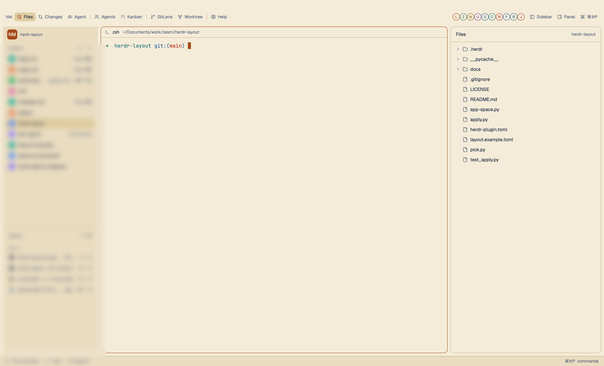

# NM Dev Layout

A Herdr app layout: top navigation bar, brand row, spaces + agents sidebar, pane
cards, a `Changes` / `Files` / `Agent` panel stack and a status bar.



Built with `nm-nav` (the top bar) and `nm-logo` (the brand row); everything else is
Herdr's own mods. `RECIPE.md` is the brief another agent can rebuild it from.

## Install

```sh
cp layouts/dev-layout.json layouts/dev-layout.png ~/.config/herdr-app/layouts/
cp -R mods/nm-nav mods/nm-logo ~/.config/herdr-app/mods/
herdr-app check ~/.config/herdr-app/mods/nm-nav
herdr-app do layout.switch --name dev-layout
```

The `.png` is only the thumbnail the settings screen shows for the layout.

Your current layout and files are untouched; delete the two mod folders and the
layout file to remove it.

## Optional keys

`~/.config/herdr-app/keys.json`:

```json
{
  "global": {
    "cmd-shift-b": "layout.toggle:sidebar",
    "cmd-shift-a": "layout.toggle:panel"
  }
}
```

The nav tooltips show these keycaps automatically.

## Notes

- The nav icons ship inside the mod (`mods/nm-nav/icons/`, from lucide-static, ISC).
- Ten Straw Hat chips sit in the top bar: initials in theme tones with
  `Name — role` tooltips. Edit `CREW` in `mods/nm-nav/main.js` to change the crew.
- Only `nm-nav` and `nm-logo` are custom; do not replace Herdr's shipped mods.
- Widths/heights are defaults; drags are saved in `layouts/.state/`.

MIT licensed.
