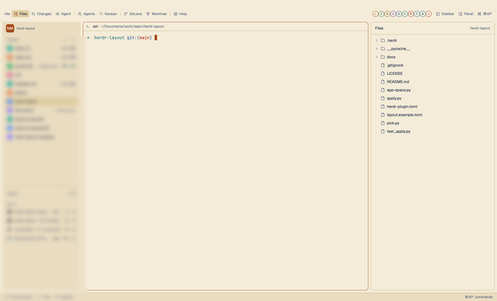

# NM Dev Layout

A Herdr window with a top navigation bar, a compact brand row above the spaces
list, and a three-region body: sidebar on the left, the active tab's panes in the
middle, and a stack panel (`Changes` / `Files` / `Agent`) on the right, closed by a
thin status bar.

## What you see

Top to bottom, left to right.

**Top bar** — 38px tall, part of the window drag area, `chrome` background. Starts
with a small `NM` label (11px semibold, dim, 6px sides). Then four button
groups separated by 1px dividers (`border`, 14px tall, 4px sides): `Files`,
`Changes`, `Agent` · `Agents`, `Kanban` · `GitLens`, `Worktree` · `Help`. Each
button is 24px tall, 7px horizontal padding,
6px gap, 6px radius, 12px text, a 13px icon, `muted` text/`dim` icon; hover gives
`raised` background and `foreground` text; the button whose panel is showing gets a
`selected` background and `accent` icon. After a flexible spacer sit the crew
chips (see below), then `Sidebar`, `Panel` and the command-palette button, whose
label is the keycap bound to `app.palette` (`⌘⇧P` on this Mac), or the word
`Commands` when no key is bound to it.

**Crew chips** — ten 20×20 circles, 1px `border_color` ring, 10px semibold initial,
one per Straw Hat: `L` Luffy ( captain, `accent`), `Z` Zoro (refactorer, `ansi2`),
`N` Nami (navigator, `ansi3`), `U` Usopp (tester, `ansi5`), `S` Sanji (cook,
`ansi4`), `C` Chopper (medic, `ansi6`), `R` Robin (reader, `ansi1`), `F` Franky
(devops, `ansi4`), `B` Brook (soul, `ansi6`), `J` Jinbe (helmsman, `ansi1`). Their
tooltip is `Name — role`.

**Sidebar** — 264px wide (`chrome`), resizable 44–460px.

- **Brand** — 44px tall: a 28×28 rounded (7px) `accent` square with `NM` in 13px
  semibold `accent_foreground`, then `herdr-layout` in 11px semibold `dim`.
- **Spaces** — takes weight 1 of the remaining height (min 90px): Herdr's shipped
  spaces list (name, branch/ahead/behind, uncommitted files, agent dots, filter).
- **Agents** — weight 2 (min 120px): Herdr's shipped agents list.

**Middle** — the active tab. Each pane is a card: 10px radius, 8px gap, 1px
`border`, 1px `accent` focus ring, `background` fill, a 30px always-visible header
in the `pane` mod, `lone` (a single pane still gets the card look). Body padding 8px,
terminal padding 12px.

**Right panel** — 340px stack (`chrome`-adjacent block), resizable 240–800px, with
three children in this order: `changes`, `files`, `agent-progress`. Only one shows;
the default is `agent-progress` ("Agent").

**Status bar** — 28px, the shipped `workspace-status` mod: `N agents · M needs you`;
clicking `needs you` focuses the blocked agent.

**Canvas** — `canvas` background, 1px `border` dividers between regions.

## How it behaves

- `Files` / `Changes` show that child in the right panel and light up while it is the
  active child.
- `Agent` is a toggle: if the panel is already showing the agent child it hides the
  whole right panel; otherwise it shows the panel on the agent child.
- `Agents`, `Kanban`, `GitLens`, `Worktree` open that mod as an overlay
  (`mod.open`), they do not change the layout.
- `Help` runs `app.help` (the keybind list).
- `Sidebar` toggles the `sidebar` node; `Panel` toggles the `panel` node. The window
  keeps working when either is hidden; the middle area grows.
- Every button has a tooltip. The tooltip text is built at render time from the
  user's `keys.json`, so it always shows the key that is really bound (or nothing).
- The crew chips are decoration: hover shows `Name — role`, clicking does nothing.
- Hover/selected states are the only motion; nothing animates on its own.
- Right-click, drag-to-resize and tab drag are Herdr's defaults, untouched.

## Built from

`layouts/dev-layout.json`:

- root `row` → one `workspace` `column` (`canvas`, `terminal_padding` 12/12,
  `divider` 1px `border`).
- `topbar` `block` 38px, `nm-nav`, `window_drag: true`.
- `body` `row`, padding 8, gap 8:
  - `sidebar` `column` 264px (min 44, max 460, `chrome`): `brand` 44px `nm-logo`
    (`window_drag`) → `spaces` `weight 1`, min 90 → `agents` `weight 2`, min 120.
  - `main` `block` with `tab: "active"` and a `pane` header (`pane` mod, 30px,
    `reveal: "always"`, top), radius 10, gap 8, `border` 1px,
    focus `accent` 1px, `background`, `lone: true`.
  - `panel` `stack` 340px (min 240, max 800) with children `changes`, `files`,
    `agent-progress`; `active: "agent"`.
- `status` `block` 28px, `workspace-status`.

`mods/nm-logo/main.js` — one `View`, `h_flex` size_full, px 12, gap 8; square
`t.accent`, radius 7; text `NM` / `herdr-layout`.

`mods/nm-nav/main.js` — one `View`; data is three arrays: `GROUPS` of
`[label, icon, action]`, `RIGHT` of `[label, icon, {toggle}]`, plus the palette
button. Action shapes: `{panel}`, `{togglePanel}`, `{mod}`, `{run}`, `{toggle}`,
`null` (palette). Helpers: `find(tree, id)`, `caps(key)` (platform keycaps via
`window().platform`), `cap(action, args)` (scans `keys()` globals, and `layout:<name>`
JSON actions), `tip(action, label)`, `act(action)` (the `run(...)` calls:
`app.palette`, `layout.show`, `layout.select`, `layout.hide`, `layout.toggle`,
`mod.open`).

`mods/nm-nav/main.js` icons: `mods/nm-nav/icons/<name>.svg` — `folder-tree`,
`git-compare`, `eye`, `users`, `kanban`, `git-branch`, `git-fork`, `life-buoy`,
`panel-left`, `panel-right`, `command`, `skull` (the last one is spare). They are
icons from lucide-static (ISC license, notice kept in each file), copied in so the
mod owns its art.

Shipped mods it relies on: `spaces`, `agents`, `changes`, `files`,
`agent-progress`, `workspace-status`, `pane`.

## Watch out

- The icons live in `mods/nm-nav/icons/`; keeping them out of Herdr's `mods/kanban`
  and `mods/workspace-chrome` is deliberate, so this layout does not break when
  those mods change.
- The crew are initials, not character art: no free-licensed One Piece artwork
  exists, so there is nothing copyrighted in this repo. Swap `CREW` for your own
  names/tones, or replace a chip's `div()` with `image("…")` if you have art.
- Do not copy Herdr's own `spaces`, `agents`, `changes`, `files`, `pane`,
  `agent-progress`, `workspace-status` from this recipe — only `nm-nav` and
  `nm-logo` are custom. Overwriting the shipped ones changes everyone's window.
- Tooltip keycaps read the user's `keys.json`. With no bindings for
  `layout.toggle:sidebar`, `layout.toggle`, or `app.palette`, tooltips simply omit
  the hint; the buttons still work.
- The layout has no `ratio` and no saved widths: a user's drags live in
  `layouts/.state/`, and the JSON only sets defaults.
- macOS traffic lights need the sidebar ≥ 76px before the brand row reads well;
  the JSON min is 44px.
- The layout's settings-screen thumbnail is `layouts/dev-layout.png` (the `preview`
  key). The `.svg` it shipped with was a hand-drawn stale copy with no `Agent`
  button, so it was replaced.
- The preview blurs the sidebar names; retake it with `herdr-app shot` if you want a
  clean one (the blur avoids publishing other people's project names).

## Done when

- `herdr-app check mods/nm-nav` and `herdr-app check mods/nm-logo` pass.
- `herdr-app do layout.switch --name dev-layout` shows the six regions with the sizes
  above (top bar 38, brand 44, sidebar 264, panel 340, status 28, gaps 8).
- `Files` fills the right panel with the file tree and the button lights up;
  `Changes` does the same; `Agent` twice hides and restores the right panel.
- `Sidebar` and `Panel` hide and restore their regions without leaving a gap.
- Tooltips show a keycap when a key is bound and no parentheses when it is not.
